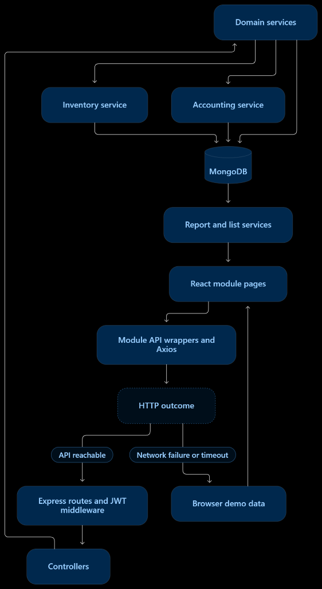
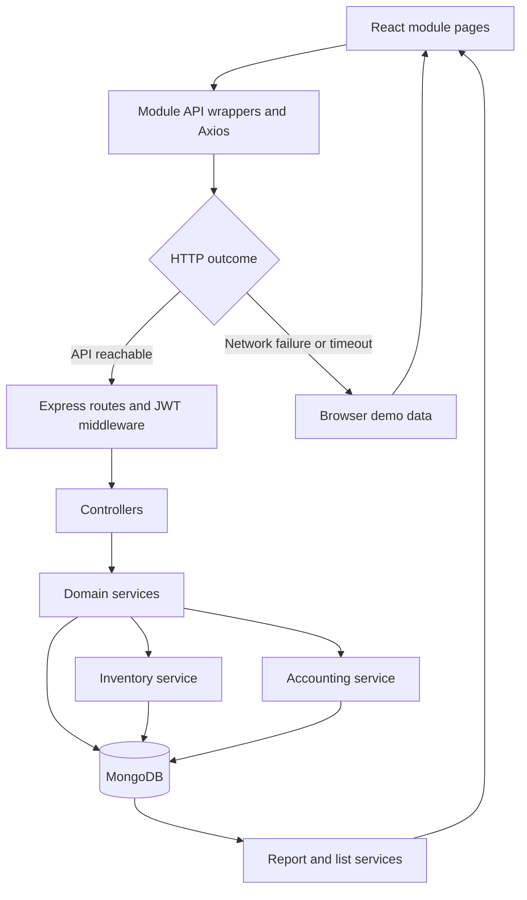
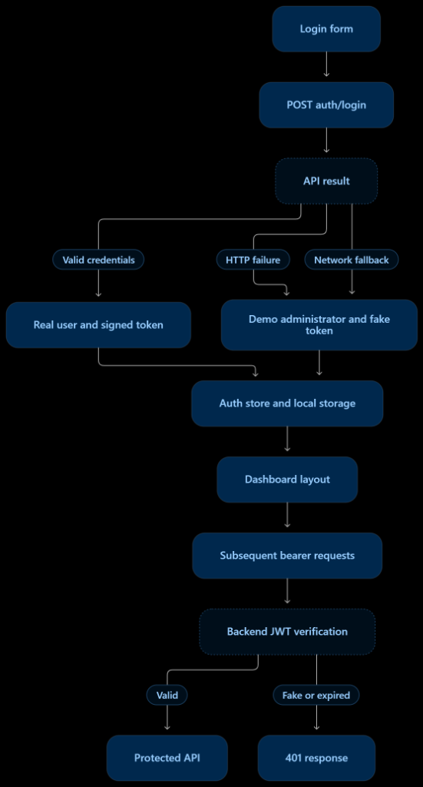
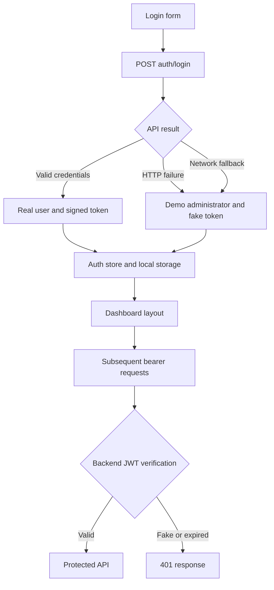
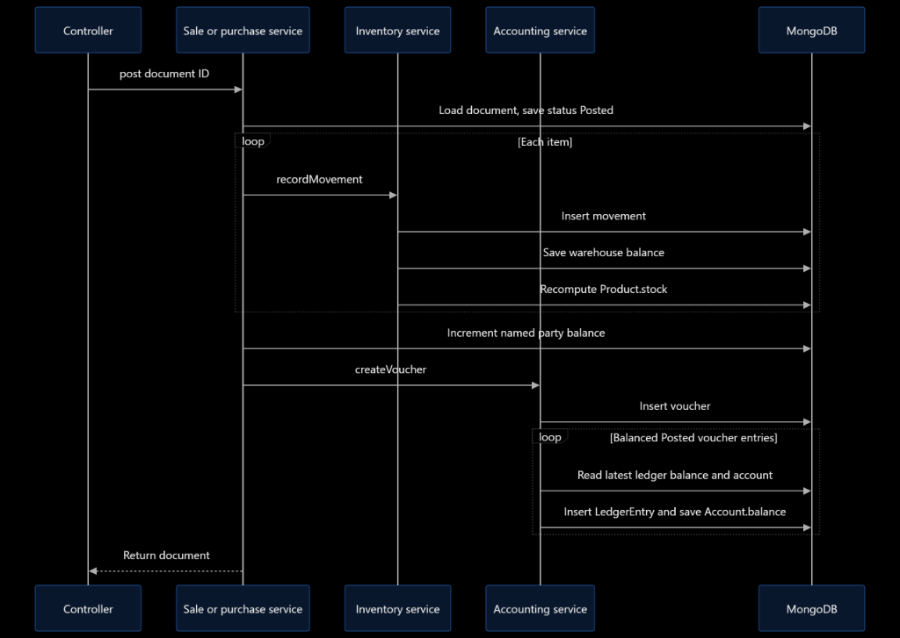
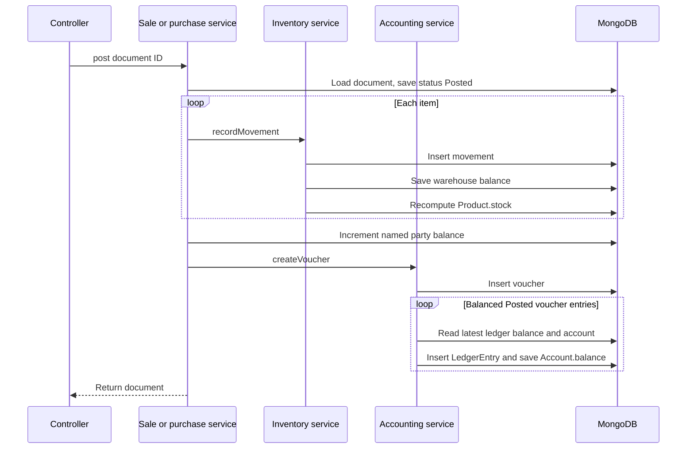
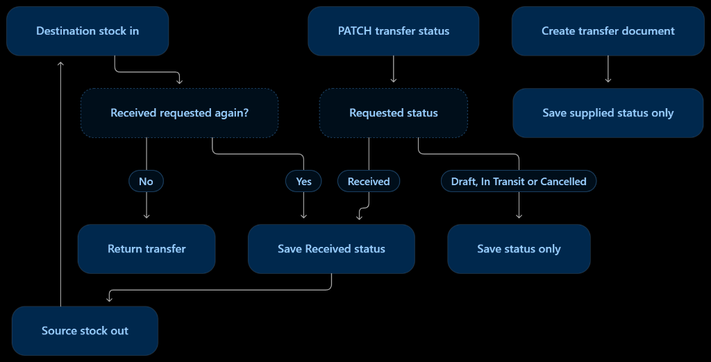
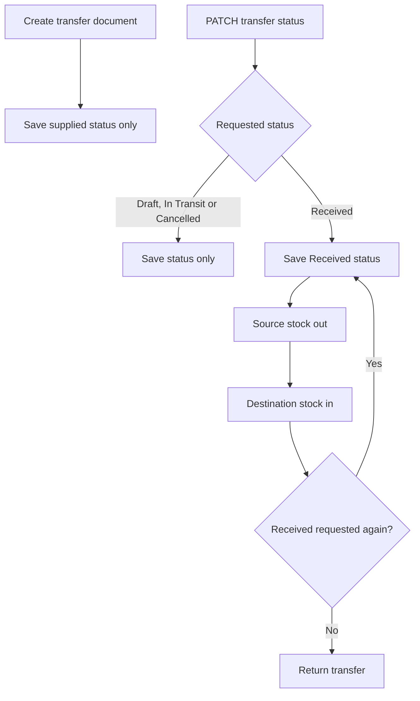
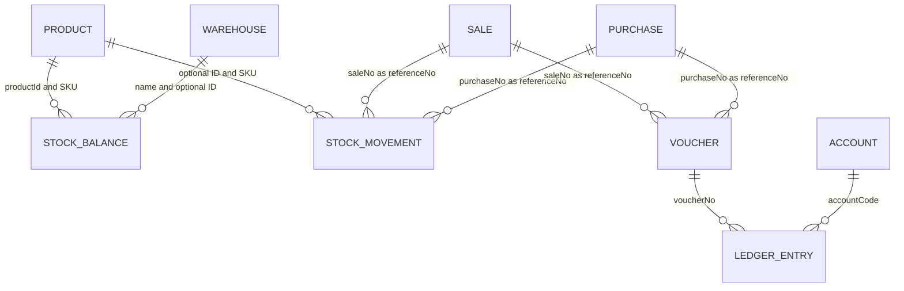

# Nexus ERP — architecture, functionality and data-flow guide

This repository contains a React/Vite ERP frontend and a Node.js/Express/Mongoose backend. It covers organization setup, products, inventory, parties, purchasing, sales, accounting, finance, logistics, users, audit views and reports.

**Implementation status:** a substantial ERP prototype with real persistence and posting services, mixed with demo behavior and incomplete integrations. It should not be described as production-ready. This guide documents the supplied source as reviewed on **3 October 2026**. It replaces the previous feature claims with code-grounded behavior. This update changes documentation only; the limitations below remain in the application.

## Contents

1. [System architecture](#1-system-architecture)
2. [Project structure](#2-project-structure)
3. [Local setup and configuration](#3-local-setup-and-configuration)
4. [Frontend request and state flow](#4-frontend-request-and-state-flow)
5. [Authentication and authorization](#5-authentication-and-authorization)
6. [Module functionality](#6-module-functionality)
7. [Stock and accounting write flows](#7-stock-and-accounting-write-flows)
8. [Document lifecycle and calculations](#8-document-lifecycle-and-calculations)
9. [Data structures and relationships](#9-data-structures-and-relationships)
10. [Reporting, search and exports](#10-reporting-search-and-exports)
11. [Infrastructure and errors](#11-infrastructure-and-errors)
12. [Verified limitations and improvement order](#12-verified-limitations-and-improvement-order)
13. [Validation and maintenance](#13-validation-and-maintenance)
14. [Complete backend route inventory](#14-complete-backend-route-inventory)
15. [Frontend route inventory](#15-frontend-route-inventory)

## 1. System architecture

The backend is a **modular monolith**: one Express process, organized into domain routes, controllers, services and Mongoose models. The frontend is a separate single-page application. There are no independent inventory/accounting microservices, message queue, background posting worker or database transaction coordinator in the supplied code.





The diagram shows the logical read/write path; responses travel back through controllers and Axios. MongoDB stores business documents and derived balances. React Query holds browser query results. Zustand holds login and UI state. Uploaded files live on backend disk.

The two main **transaction-effect helpers** are `inventoryService.recordMovement()` and `accountingService.createVoucher()`. They centralize many stock and accounting effects, but **not every write** passes through them: master-data CRUD, document creation, party balance updates, logistics, audit records, seed data and initial product stock write directly to models.

The design is movement-oriented but is not a complete event-sourced system: opening stock can be inserted without movements, balances can be edited separately, and no replay/reconciliation command is provided.

| Layer | Responsibility | Source |
| --- | --- | --- |
| Application entry | Mount React, providers and router | `frontend/src/main.jsx`, `app/App.jsx` |
| UI modules | Forms, lists, filters, charts and actions | `frontend/src/modules/` |
| Browser state | Query cache, current identity and UI selections | `app/providers.jsx`, `store/` |
| HTTP adapter | Base URL, bearer token, response envelope and demo fallback | `frontend/src/api/axios.js` |
| API routes | URL/method dispatch and JWT gate | `backend/src/routes/` |
| Controllers | Read request inputs, call services, return JSON | `backend/src/controllers/` |
| Services | Business calculations and orchestration | `backend/src/services/` |
| Models | Document shapes, defaults, enums and selected unique indexes | `backend/src/models/` |
| Infrastructure | MongoDB, Redis helper, Socket.IO, uploads, errors | `backend/src/config/`, `middlewares/` |

## 2. Project structure

Paths below are relative to the project root. Each frontend domain normally has a `*.api.js` adapter and one or more page folders. Backend domains generally have matching route, controller and service files.

| Path | Contents and purpose |
| --- | --- |
| `README.md` | This architecture and operating guide |
| `frontend/package.json` | Frontend dependencies and dev/build/lint/test scripts |
| `frontend/vite.config.js` | Vite configuration |
| `frontend/.env.example` | Browser API base URL template |
| `frontend/public/` | Static icons, placeholders and manifest |
| `frontend/src/app/` | App root, providers and full route registry |
| `frontend/src/layouts/` | Active dashboard/auth layouts, sidebar, header and breadcrumbs |
| `frontend/src/components/ui/` | Buttons, inputs, cards and supporting UI primitives |
| `frontend/src/components/tables/DataTable.jsx` | Shared tabular UI |
| `frontend/src/components/common/` | Page/KPI helpers and global search |
| `frontend/src/modules/` | Accounting, audit, auth, dashboard, finance, inventory, logistics, organization, parties, products, purchases, reports, sales and users |
| `frontend/src/api/` | Axios client, endpoint constants and sample datasets |
| `frontend/src/store/` | Zustand auth and UI stores |
| `frontend/src/utils/` | Formatting, permission helper and export functions |
| `frontend/src/hooks/useApi.js` | Unused hook with an invalid named `api` import |
| `frontend/src/styles/` | Shared styling |
| `backend/package.json` | Server dependencies and dev/start scripts |
| `backend/.env.example` | Server configuration template |
| `backend/src/server.js` | Express/HTTP bootstrap, middleware, health and static uploads |
| `backend/src/routes/index.js` | Mounts all domain routers under `/api` |
| `backend/src/controllers/` | HTTP-facing handlers |
| `backend/src/services/` | Domain logic and cross-module side effects |
| `backend/src/models/` | Mongoose schemas, grouped by domain; `index.js` re-exports them |
| `backend/src/config/` | Environment, MongoDB, Redis and Socket.IO |
| `backend/src/middlewares/` | Authentication, errors, cache and Multer |
| `backend/src/utils/` | `ApiError`, `asyncHandler`, response helpers |
| `backend/src/seed.js` | Explicit demo-data initialization |
| `backend/uploads/` | Runtime upload destination, created as needed |

`frontend/src/components/ModulePage.jsx`, `components/Sidebar.jsx` and `components/Dashboard.jsx` are legacy/unreferenced components in the inspected application import graph. The active sidebar is under `layouts/`, and the active dashboard is under `modules/dashboard/pages/`.

### Stack declared in package manifests

Frontend: React 19, Vite 7, React Router 7, TanStack Query 5, Zustand 5, React Hook Form, Zod, Tailwind CSS 4, Recharts, Lucide, Sonner, SheetJS and jsPDF. Backend: Express 5, Mongoose 8, bcryptjs, jsonwebtoken, dotenv, Helmet, CORS, Morgan, express-rate-limit, Multer, Redis and Socket.IO. A dependency being installed does not establish that its features are integrated. There is no frontend `socket.io-client` dependency.

## 3. Local setup and configuration

Use a Node.js release compatible with the checked-in dependencies and npm. Start a local MongoDB instance, or configure another MongoDB URI. Redis is optional for startup because its connector falls back to memory; no routes currently use the response cache. There is no root-level workspace script or Docker deployment configuration supplied.

From the project root, in one terminal:

```bash
cd backend
cp .env.example .env
npm install
npm run dev
```

In a second terminal:

```bash
cd frontend
cp .env.example .env
npm install
npm run dev
```

On Windows PowerShell, use `Copy-Item .env.example .env` instead of `cp` if preferred. Configure the files before starting the applications. These are source-derived setup instructions, not a claim that an external database or clean dependency install was tested during this documentation review.

| Setting | Default/example | Meaning |
| --- | --- | --- |
| Backend `PORT` | `5000` | HTTP and Socket.IO server port |
| Backend `NODE_ENV` | `development` | Logging and error-stack behavior |
| Backend `MONGO_URI` | `mongodb://127.0.0.1:27017/nexus_erp` | Persistent business database |
| Backend `JWT_SECRET` | Example says `change-me-in-production`; code fallback is `dev-secret` | Token signing key; set a private strong value |
| Backend `CLIENT_URL` | `http://localhost:5173` | Allowed HTTP and socket origin |
| Frontend `VITE_API_URL` | `http://localhost:5000/api` | Axios base URL |
| Redis URL | `redis://127.0.0.1:6379` in connector | `redis.js` reads `env.REDIS_URL`, but `env.js` does not export it; adding it only to `.env` has no effect today |

The frontend commonly runs at `http://localhost:5173`; backend health is `http://localhost:5000/api/health`. Health reports static feature flags, not a readiness/integration assessment.

### Optional demo seed

**Run only against a disposable development database.** The seed deletes and recreates selected collections. It does not comprehensively clear/rebuild every transaction collection, so reseeding an active database can leave inconsistent references and balances.

```bash
cd backend
node src/seed.js --run
```

The `--run` argument is required: running `node src/seed.js` alone does not execute `seedDatabase()`.

| Seeded login | Password | Role |
| --- | --- | --- |
| `admin@nexus.com` | `admin123` | Administrator |
| `accountant@nexus.com` | `admin123` | Accountant |

The login page pre-fills `Password123!`, which differs from the seeded password. The previous README's `finance@nexus.com` and inventory-manager credentials are not created by this seed. Demo login bypasses can conceal this mismatch.

Frontend commands: `npm run dev`, `npm run build`, `npm run preview`, `npm run lint`, `npm test`. Backend commands: `npm run dev`, `npm start`. No backend test script is declared. A test command/dependency alone does not establish coverage.

## 4. Frontend request and state flow

A normal list page calls `useQuery`, which calls the domain API wrapper, which calls `apiClient`. A form uses local/form state and a mutation. On success, many pages invalidate queries, display a toast and close a modal or navigate back to a list. The exact query invalidation scope varies by page; cross-module refresh is not coordinated by server events.

`AppProviders` creates one QueryClient with a three-minute stale time, one retry and no refetch on window focus. This **browser query cache exists**, even though backend Redis response caching is unused.

`useAuthStore` persists user and token in local storage under `nexus_erp_auth_user` and `nexus_erp_auth_token`. `useUiStore` holds sidebar state, selected branch/warehouse/currency, search visibility and fiscal-year text. Those UI selections do not automatically enforce backend branch access or currency conversion.

### Response shape

Controllers normally use `ok()`:

```json
{
  "success": true,
  "message": "OK",
  "data": []
}
```

Axios returns `response.data`, so an API wrapper returns this envelope rather than the original Axios response. Most pages read `result.data`. `dashboardApi.getDashboardData()` unwraps the business `data` one more time, so the dashboard receives `{ kpis, charts, recentTransactions }` directly.

### Demo fallback behavior

Axios has a four-second timeout. Network errors, timeouts and missing HTTP responses invoke an in-memory mock handler. This is not an offline synchronization implementation:

- GETs return sample collections and generally ignore server-side filters and record-ID semantics.
- POSTs prepend a record to a browser-memory collection; they do not perform real posting, stock or ledger effects.
- PUT/PATCH return a success body without actually updating the mock collection; DELETE returns success without deleting it.
- Unmapped URLs return a generic successful empty result. The dashboard has a special sample response.
- These mock changes are not saved to MongoDB or queued for later replay and are lost when the module reloads.
- Actual HTTP errors such as 400, 401, 404 or 500 are rejected rather than handled by this network fallback. The login page separately catches errors and signs in a demo administrator.

Consequently, a green toast or populated table is not proof that the API accepted a business write. Inspect the HTTP response and database effects during integration testing.

## 5. Authentication and authorization

### Backend login

`POST /api/auth/login` passes email/password to `authService.login()`. It lowercases the email, loads an active User, checks bcrypt, updates `lastLogin`, and issues a seven-day JWT containing ID, name, email, role(s), permissions, branches and warehouses. `GET /api/auth/me` returns the verified token claims rather than reloading current user/role state.

Protected domain routers call `auth`, which requires a `Bearer` token and verifies its signature/expiry. The frontend's fake demo token is not a valid backend login token. Authentication still blocks unauthenticated requests to those routers.





### Current access-control gaps

- Auth state starts with `isAuthenticated: true` and a default administrator, including on a fresh browser load.
- `DashboardLayout`/`AuthLayout` check only that browser boolean. Logout clears it for the running session, but a reload initializes it to true again.
- The login page supplies demo admin credentials on any rejected login, including a 401 if returned. In this backend, wrong credentials currently throw plain `Error`, which the error handler generally turns into **500**, not 401.
- `requirePermission` is defined but never applied to routes. It checks Administrator or an exact permission string; it does not interpret `'*'` as a wildcard.
- Frontend `hasPermission()` is not used to gate the inspected pages/actions.
- Role documents contain a permission map, whereas User/JWT permissions are a string array. No resolver joins the role map into authorization checks.
- Public registration accepts supplied roles/permissions and defaults permissions to `['*']`. Restrict registration and privileged fields before treating this as an access-controlled ERP.
- Branch and warehouse assignments are token data, not enforced query scopes. Active-user/permission changes are not rechecked on each request.

Sources: `auth.service.js`, `middlewares/auth.js`, `routes/auth.routes.js`, `store/authStore.js`, `modules/auth/LoginPage.jsx`, `layouts/DashboardLayout.jsx`.

## 6. Module functionality

### Organization

Branches, warehouses, shops and currencies have list/create/update/delete API operations and UI management pages. Warehouses store a branch name; shops store branch and warehouse names. Currency create/update clears other `isBase` flags when setting a new base currency. These operations are independent writes, with no transaction enforcing a single base currency under concurrent requests.

Currency records store exchange rates, but sales/purchase posting does not convert amounts into a common base currency. Multi-branch records are also not equivalent to isolated multi-tenant organizations: no organization/tenant ownership key is enforced across the schemas.

### Products and catalog

Products have SKU/barcode, category/unit/packing labels, cost/sale prices, reorder level and aggregate stock. Product creation writes Product and initializes a StockBalance at `Main Warehouse` from `data.stock`. It does not generate an opening StockMovement or accounting voucher. Product update/delete acts directly on Product without stock reconciliation or cascading cleanup.

Categories support CRUD; quantity and packing units support list/create/delete. Packing `baseQuantity` describes packaging but posting uses supplied quantities directly; no packing conversion engine is called. Product filters support search, category and status. Catalog mutation URLs in the frontend need correction, detailed below.

### Parties

Customers, suppliers, transporters and employees have management APIs and form/list pages. Customer/supplier/transport balances are fields on the party document, not an independently reconciled subledger. New codes are generated from collection counts if omitted. Opening balance is stored separately and does not automatically create an opening voucher.

Owners and partnerships are displayed in dedicated pages. Their services contain additional create/update methods, but the router exposes only GET for these two types. Saraf exchange parties have GET/POST API support; the inspected page displays the list. Employee salary, owner capital/drawings, partnership ratios and Saraf balances are stored values, not payroll, capital-allocation or foreign-exchange posting engines.

### Purchases

The purchase form loads suppliers/products and offers draft creation or posting. The service calculates totals, creates Purchase and, if the request explicitly says `Posted`, runs `postPurchase()`. Existing documents can also be posted by PATCH. Posting creates stock-in movements, increases the named supplier's balance by `balanceAmount`, then creates an Inventory/Payable voucher for the full `grandTotal`.

The list supports status filtering and posting. Generic update writes supplied fields directly; it does not recalculate totals or reverse/repost existing effects. There is no purchase deletion route, receiving-match workflow, freight capitalization engine or separate purchase-order-to-invoice conversion service.

Purchase returns are separate documents. Creation with `Approved` creates stock-out movements. It does not reduce supplier balance, issue a refund/payment or reverse accounting. A draft return cannot later be approved through a dedicated route in this version.

### Sales

The sales form loads customers/products, calculates a preview, supports drafts and posting, and uses browser printing. Server posting marks the Sale as Posted, creates stock-out movements, increases customer balance by `balanceAmount`, and creates a Receivable/Sales Revenue voucher for `grandTotal`.

There is no server-side availability rejection, reservation workflow or credit-limit enforcement. No Cost of Goods Sold/Inventory journal is posted on sale. Sales return creation with `Approved` adds stock but does not adjust customer balance or reverse revenue. Backend return creation is separate from the incorrect frontend URL presently used. Both return forms also hardcode one sample SKU (sales: `SKU-DRL-001`; purchases: `SKU-HYD-002`) with quantity 1 instead of selecting original invoice lines, and omit the required `branch` field. Correcting the URL alone therefore does not complete the return workflow.

### Inventory

Stock and movement pages are read views. Transfers, adjustments and damage pages create domain documents. Transfer status changes can create movements; adjustments act only when created with `Posted`; damage immediately deducts stock on creation regardless of status. All use the shared movement service for these effects. Detailed quantities and trigger timing appear in sections 7 and 8.

### Accounting and finance

Chart of accounts exposes CRUD and account hierarchy metadata. Banks, cashbooks, capital, assets, liabilities, income and property pages are filtered views of Account records, not separate bank-integration, fixed-asset or depreciation systems. The expenses accounting view filters Account records with type Expense; it is not an expense-entry screen. The finance API supports expense creation and automatic journal creation even though not every backend operation has a matching frontend form.

Payments and receipts have entry forms and list pages. They save a financial document, update the relevant supplier/customer balance, then generate an automatically posted voucher. They do not allocate a payment to individual invoices or update invoice `paidAmount`/`receivedAmount`, payment status or due balance after creation.

Payment/receipt voucher pages are filtered Voucher lists. Journal vouchers allow manual entries and a frontend balance check. Ledger queries filter by account, branch and optionally a date interval. The general voucher service can create a Posted balanced voucher, but the router has no separate endpoint to post an existing draft voucher. Manual vouchers do not change party balances or inventory.

### Logistics

Shipments store order references, transporter/vehicle, driver, origin/destination, freight, tracking and delivery dates. Vehicles and deliveries have their own records. The backend supports list/create/update for all three; the frontend shipment page includes creation, while vehicle/delivery pages are list views in the inspected source.

These services update logistics records only. Marking a shipment Delivered does not post a sale, receive a warehouse transfer, update inventory, charge freight, update vehicle availability or synchronize Sale.deliveryStatus. Tracking is a stored string; there is no external carrier integration.

### Users and roles

User CRUD hashes passwords on create/update and usually excludes `passwordHash` from list/create/update results. If a create request omits a password, the service uses `Password123!`. Roles store a per-module action matrix. Management screens exist, but enforcement is absent and frontend role mutation URLs also have the `/all` mismatch. Role edits do not automatically refresh existing JWT permissions.

### Audit

Activity and transaction-history pages read AuditLog records. `auditService.logAction()` compares keys in `newData` against `oldData` using JSON serialization and stores changed field names. The HTTP POST controller supplies identity from token claims. It does not automatically capture entity changes from other services, and deleted-only keys are not found by iterating just `newData` keys.

No mutation service calls the audit helper, and the frontend does not call `auditApi.logAction()`. Seed data creates an initialization log. Audit has no update/delete routes, but that alone is not tamper-proof or immutable storage, and manually submitted event details are not independent evidence of a business mutation.

## 7. Stock and accounting write flows

### Action effect matrix

This table describes real backend services, not the browser mock adapter.

| Trigger | Stock effect | Party effect | Automatic debit / credit |
| --- | --- | --- | --- |
| Purchase posted | In per item | Supplier `+ balanceAmount` | 1200 Inventory / 2100 Payable, full grand total |
| Sale posted | Out per item | Customer `+ balanceAmount` | 1100 Receivable / 4000 Sales Revenue, full grand total |
| Payment created | None | Supplier `- amount`, only for Supplier party type | 2100 Payable / 1020 Bank |
| Receipt created | None | Customer `- amount`, only for Customer party type | 1010 Cash / 1100 Receivable |
| Expense created | None | None | 5000 Expense label / 1010 Cash |
| Transfer status set to Received | Out source, then in destination | None | None |
| Adjustment created as Posted | In for positive difference; out for negative | None | None |
| Damage created | Out by damaged quantity | None | None |
| Sales return created as Approved | In | None | None |
| Purchase return created as Approved | Out | None | None |
| Manual Posted balanced voucher created | None | None | Supplied entry accounts |

Finance side effects run even if a caller supplies Draft or Cancelled payment/receipt status, or a draft expense; those services do not gate effects by status. Payment mode/account display names do not select different GL codes. Notably, seeded code **5000 is COGS**, while expenses use it as a generic expense code; seeded operational expense code 5100 is not chosen by the expense service.

### Posting sequence





Every step is individually awaited, but there is no shared MongoDB session/transaction. A failure after status is saved leaves a partly applied Posted document. Retrying can duplicate earlier effects.

### `inventoryService.recordMovement()`

1. Count movements and generate `MOV-00001`-style number.
2. Insert StockMovement with document reference, SKU, warehouse, quantities and unit cost.
3. Find StockBalance by **`productSku + warehouseName`**, or create it.
4. Set `onHand = max(0, previousOnHand + qtyIn - qtyOut)`.
5. Set `available = max(0, onHand - reserved - damaged)` and update movement time.
6. Sum on-hand balances for the SKU across warehouses and update `Product.stock`.

There is no sufficient-stock check. Example: selling 7 while holding 5 records an outflow of 7 but stores on-hand as 0; the missing 2 units are hidden by clamping. Concurrent read-modify-save calls can lose balance updates. There is no unique compound index on the stock-balance SKU/warehouse key. Damage reduces on-hand but does not increment the `damaged` field. The service contains no reservation lifecycle.

StockBalance requires `productId`, while sales/purchase line IDs are optional. A movement for an item without an existing balance can therefore insert the movement and then fail when trying to create its required-ID balance. Forms and integrations should resolve the actual Product ID.

### `accountingService.createVoucher()`

The helper generates a document number, sums numeric debits/credits and sets `isBalanced` when `abs(totalDebit - totalCredit) < 0.01`. It **creates the Voucher even when unbalanced**. It writes ledger entries only when status is Posted and `isBalanced` is true. Thus a voucher can be stored with status Posted but no ledger impact.

For each posted line, `postVoucherToLedger()` loads the latest LedgerEntry by **creation time** for the account code. Its running balance starts from that record, or zero if none exists:

```text
Asset or Expense: delta = debit - credit
Liability, Equity or Revenue: delta = credit - debit
runningBalance = previousLedgerRunningBalance + delta
```

It inserts one LedgerEntry and overwrites matching Account.balance. Missing accounts are not rejected: the credit-normal branch is used and no Account is updated. It does not initialize from a pre-existing Account.balance, so seed/manual opening balances can be overwritten on the first ledger posting. Balances are global by account code, even when querying a branch. Backdated entries are not followed by chronological balance recalculation, and concurrent posts can calculate from the same prior balance.

Voucher totals being mathematically balanced does not establish correct account selection, valid party allocation or inventory valuation. There is no fiscal-period closure, reversal engine or duplicate-posting key.

### Warehouse transfer timing





Creation itself does not move stock, even if created with Received. Setting In Transit does not remove or reserve source stock; both directions happen on receipt. Status changes are not restricted by a transition state machine. Cancelled does not reverse prior movements.

## 8. Document lifecycle and calculations

### Sales and purchase calculations

On create, the backend recomputes:

```text
line.total = quantity * unitPrice - line.discount + line.tax
subtotal = sum(line.total)
grandTotal = subtotal - header.discount + header.tax
purchase.balanceAmount = grandTotal - paidAmount
sale.balanceAmount = grandTotal - receivedAmount
```

Tax and discount are absolute amounts in this calculation, not percentages. There is no freight term, currency conversion or money rounding policy. Frontend previews use Number conversions and clamp some totals to zero; the backend does not fully normalize all numeric inputs before JavaScript arithmetic. Use numeric JSON values: string taxes can cause concatenation before Mongoose casts the result.

Invoice amounts already paid/received lower the party balance increment, but the automatically posted receivable/payable voucher remains the full grand total, with no automatic cash settlement voucher for that initial amount. Later payment/receipt records do not update the invoice. Party balances, invoice balances and GL balances can therefore diverge.

| Document | Schema status values | Actual effect trigger |
| --- | --- | --- |
| Sale / Purchase | Draft, Approved, Posted, Cancelled | Create with Posted, or PATCH `/:id/post` |
| SaleReturn / PurchaseReturn | Draft, Approved, Completed | Create with Approved only |
| WarehouseTransfer | Draft, In Transit, Received, Cancelled | PATCH status to Received only |
| StockAdjustment | Draft, Approved, Posted | Create with Posted only |
| StockDamage | Reported, Approved, Disposed | Every create |
| Voucher | Draft, Approved, Posted, Cancelled | Create with Posted and balanced |
| Payment / Receipt | Draft, Completed, Cancelled | Every create |
| Expense | Draft, Approved, Paid | Every create |
| Shipment | Pending, Loaded, In Transit, Delivered, Cancelled | Record updates only |
| Vehicle | Available, On Trip, Maintenance | Record updates only |
| Delivery | Scheduled, Out for Delivery, Delivered, Failed | Record updates only |

Enums define allowed stored values, not an approval workflow. Many updates use `findByIdAndUpdate` without `runValidators: true`; there is no uniform transition validation. Generic document updates can bypass posting logic, and changing status to Cancelled does not automatically reverse stock or accounting.

## 9. Data structures and relationships

All business schemas use Mongoose timestamps (`createdAt`, `updatedAt`) and MongoDB `_id`. Most document identifiers/codes are uniquely indexed, but relationships are a mixture of optional ObjectId references and duplicated strings. References do not by themselves enforce relational foreign-key constraints.

### Organization and catalog (`models/OrgAndProducts.js`)

| Model | Main fields | Relationships / purpose |
| --- | --- | --- |
| Branch | code, name, city, address, phone, email, isHeadOffice, status | Organization location; unique uppercase code |
| Warehouse | code, name, branch, location, capacity, isPrimary, status | Branch is a string name |
| Shop | code, name, branch, warehouse, phone, status | Branch/warehouse strings |
| Currency | code, name, symbol, exchangeRate, isBase, status | Currency master; unique uppercase code |
| Category | code, name, parentCategory, description, status | Parent stored as string |
| QuantityUnit | code, name, symbol, status | Unit master |
| PackingUnit | code, name, baseQuantity, quantityUnit, status | Packaging metadata |
| Product | sku, barcode, name, category, unit, packingUnit, costPrice, salePrice, reorderLevel, stock, description, active, status | Unique uppercase SKU; stock is aggregate projection |

### Parties (`models/Parties.js`)

Customer, Supplier and Transporter share: `code`, `name`, `companyName`, `email`, `phone`, `address`, `city`, `openingBalance`, `currentBalance`, `creditLimit`, `taxNumber`, `status`. Codes are unique; names are not declared unique even though posting updates parties by name.

| Model | Additional or separate fields | Purpose |
| --- | --- | --- |
| Customer | Shared party fields | Customer master and stored receivable balance |
| Supplier | Shared party fields | Supplier master and stored payable balance |
| Transporter | Shared fields, vehicleCount, contactPerson | Carrier contact information |
| Employee | code, name, designation, department, phone, email, salary, joinDate, status | Staff master; status includes Terminated |
| Owner | name, sharePercentage, capitalInvested, drawings, phone, email | Ownership metadata |
| Partnership | name, partnerCount, agreementDate, totalCapital, profitSharingRatio, status | Agreement metadata; Active/Dissolved |
| Saraf | code, name, contactPerson, phone, marketLocation, currentBalance, currency | Exchange-party master |

### Commercial documents (`models/PurchasesAndSales.js`)

The shared embedded item structure is:

```json
{
  "productId": "optional Product ObjectId",
  "productSku": "SKU-EXAMPLE",
  "productName": "Example product",
  "quantity": 2,
  "unit": "PCS",
  "packing": "Box",
  "unitPrice": 50,
  "discount": 0,
  "tax": 0,
  "total": 100
}
```

This JSON illustrates shape; replace the descriptive ObjectId string before sending it. Item SKU/name, quantity, unit price and total are required; quantity has minimum 1 and unit price minimum 0. Item arrays embed snapshots, allowing a document to retain labels/prices, but the service still relies on SKU/name lookups for effects.

| Model | Header and amount fields | Links |
| --- | --- | --- |
| Purchase | purchaseNo, date, supplierId, supplierName, branch, warehouse, currency, items, subtotal, discount, tax, grandTotal, paidAmount, balanceAmount, status, paymentStatus, notes, createdBy | Optional Supplier ID; party update uses name |
| Sale | saleNo, date, customerId, customerName, branch, warehouse, currency, items, subtotal, discount, tax, grandTotal, receivedAmount, balanceAmount, status, paymentStatus, deliveryStatus, notes, createdBy | Optional Customer ID; party update uses name |
| PurchaseReturn | returnNo, originalPurchaseNo, date, supplierName, branch, warehouse, items, totalRefund, reason, status, createdBy | Original number is a string; no original-quantity reconciliation |
| SaleReturn | returnNo, originalSaleNo, date, customerName, branch, warehouse, items, totalRefund, reason, status, createdBy | Original number is a string; no refund engine |

Return creation accepts provided line totals and refund total; unlike invoice creation, it does not recalculate them.

### Inventory (`models/Inventory.js`)

| Model | Main fields | Data role |
| --- | --- | --- |
| StockBalance | productId, productSku, productName, warehouseId, warehouseName, onHand, reserved, damaged, available, lastMovementAt | Current warehouse projection; Product ID required, Warehouse ID optional |
| StockMovement | movementNo, date, productId, productSku, productName, warehouseName, movementType, referenceNo, qtyIn, qtyOut, unitCost, createdBy, notes | Movement history; types Purchase, Sale, Transfer, Return, Damage, Adjustment |
| WarehouseTransfer | transferNo, transferDate, sourceWarehouse, destinationWarehouse, reference, notes, items, status, createdBy | Items: productId/SKU/name, availableStock, transferQuantity, unit |
| StockAdjustment | adjustmentNo, date, warehouseName, reason, items, status, createdBy | Items: productId/SKU/name, currentStock, adjustedStock, difference, unitCost |
| StockDamage | damageNo, date, warehouseName, reason, items, status, createdBy | Items: productId/SKU/name, damagedQty, unitCost, totalLoss |

Adjustment service trusts supplied `difference` rather than deriving it from a fresh warehouse balance. Transfer `availableStock` and damage `totalLoss` are stored metadata, not server-validated inventory/cost calculations.

### Accounting (`models/Accounting.js`)

| Model | Main fields | Data role |
| --- | --- | --- |
| Account | code, name, type, category, parentAccount, currency, balance, isSystem, status | Unique code; Asset/Liability/Equity/Revenue/Expense; string parent |
| Voucher | voucherNo, voucherType, date, branch, description, referenceNo, entries, totalDebit, totalCredit, isBalanced, status, createdBy | Journal/Payment/Receipt/Sales/Purchase/Contra header with embedded entries |
| LedgerEntry | voucherNo, voucherType, date, branch, accountCode, accountName, description, debit, credit, runningBalance, partyName | Flattened posted line; partyName is not populated by the posting helper |
| Expense | expenseNo, date, category, accountName, paymentMethod, amount, paidTo, reference, branch, notes, status, createdBy | Operational expense document |
| Payment | paymentNo, date, partyType, partyName, paymentMode, accountPaidFrom, amount, referenceNo, branch, notes, status, createdBy | Outgoing money record |
| Receipt | receiptNo, date, partyType, partyName, receiptMode, accountDepositedTo, amount, referenceNo, branch, notes, status, createdBy | Incoming money record |

Voucher entries contain optional `accountId`, required `accountCode`/`accountName`, `description`, and nonnegative `debit`/`credit`. Posting resolves accounts by code, not ID. Finance amount fields are required numbers but do not consistently have positive-value minimums. Account `isSystem` is metadata; delete service does not guard system accounts or accounts used by posted entries.

### Logistics, identity and audit

| Model | Main fields | Source |
| --- | --- | --- |
| Shipment | shipmentNo, orderNo, orderType, date, transporterName, vehicleNo, driverName, driverPhone, originWarehouse, destination, freightCost, trackingNo, status, estimatedDelivery, actualDelivery, notes | `Logistics.js` |
| Vehicle | vehicleNo, type, capacityTons, driverName, driverPhone, transporter, status | `Logistics.js` |
| Delivery | deliveryNo, shipmentNo, customerName, deliveryAddress, deliveryDate, receivedBy, signatureUrl, status, remarks | `Logistics.js` |
| User | name, email, passwordHash, phone, employeeId, role, roles, branches, warehouses, permissions, active, lastLogin | `User.js` |
| Role | name, code, description, permissions, isSystem | `Role.js`; permissions Map has create/read/update/delete/approve/post flags per key |
| AuditLog | timestamp, userName, userEmail, role, module, action, entity, entityId, ipAddress, details, oldData, newData, changedFields | `AuditLog.js`; old/new data use Mixed type |

### Logical relationship map



This is a logical relationship diagram, not enforced foreign-key cardinality. Repeated posting can create multiple vouchers for one invoice. Customer/supplier links, branch/warehouse names, account codes and original document numbers can become inconsistent after renames or deletions. There are no cascade/restrict policies implemented across these services.

### Number generation

Count-based prefixes include `PUR`, `INV`, `PRET`, `SRET`, `MOV`, `TRF`, `ADJ`, `DAM`, `PAY`, `REC`, `EXP`, `SHP`, `DEL`, and voucher prefixes `JV`, `PV`, `RV`, `SV`, `PUV`, `CV`. Most use five-digit padding. Auto-generated party codes use `CUST`, `SUP`, `TRN`, `EMP`, `SRF` with four digits. Unique indexes can reject duplicates, but `countDocuments() + 1` is not an atomic sequence; concurrent calls or deletion/recreation can collide.

## 10. Reporting, search and exports

### Backend report sources

| Report | Actual inputs and calculation | Limitations |
| --- | --- | --- |
| Dashboard | Sales/purchases, party balances, StockBalance, Account, five recent sales/purchases | Today uses server-local midnight; status is not restricted to Posted; input filter ignored |
| Dashboard stock value | Sum `onHand * 25` | Fixed estimate, not costing |
| Low-stock KPI | Count balances with available ≤ 15 | Does not use Product.reorderLevel |
| Trends/category/warehouse/cash-flow charts | Hardcoded arrays | Not database aggregates |
| Sales/purchase report | All matching collection documents sorted by date | Current implementation ignores supplied filters |
| Inventory report | StockBalance sorted by onHand | No actual valuation calculation |
| Backend P&L | Posted sales revenue − posted purchase totals − all Expense amounts | Purchase totals used as COGS, not sold-stock costs; ignores reporting period |
| Backend balance sheet | Account.balance grouped into Asset/Liability/Equity | No closing-profit transfer; aggregate zeros replaced by examples |

Dashboard KPIs, P&L and balance-sheet totals frequently use `value || demoValue`. A legitimate zero becomes a sample number. P&L fallback values include revenue 150000, COGS 95000 and expenses 22000; dashboard values have their own defaults.

### Frontend report workspace

`ReportsWorkspace.jsx` only fetches sales, purchase and inventory report datasets. Customer/supplier ledger screens use `initialMockState`; P&L and balance sheet use literal local rows instead of their existing backend API wrappers. Trial Balance has no specific branch in the selection code and falls into the audit/sample-log display. Audit report data there is also mock data, separate from the actual audit module pages.

Date/branch controls are local display state. Generate shows a toast; it does not apply them to these report queries. `/reports/:reportId` exists, but the component initializes its own active report to sales instead of reading that route parameter. Aging, sales-margin and full cash-flow report engines advertised in the old README are not implemented API endpoints.

### Search and export

Global search (`Ctrl/Cmd+K`) reads static `initialMockState`, not the API or React Query cache. It computes matches for products, customers, suppliers, sales, purchases and vouchers; the rendered result sections cover products, customers, sales and purchases. Supplier/voucher matches can therefore contribute to “has results” without a rendered result list.

`utils/export.js` provides Excel, CSV and PDF export of supplied browser data. Excel/CSV serialize the passed rows; they do not re-query the database. PDF takes only `data.slice(0, 35)` and truncates cell text to 22 characters, so it is not a full report export. Printing uses `window.print()` on the current page. Sample report data will also be exported if that is what the page displays.

## 11. Infrastructure and errors

### Server bootstrap

`server.js` creates Express and an HTTP server, initializes Socket.IO, installs Helmet/CORS/body parsing/Morgan, exposes `/uploads`, applies an API rate limit (1000 requests per 15 minutes), mounts `/api/health` and domain routes, then installs not-found/error handlers. It connects MongoDB and attempts Redis before listening. MongoDB connection failure prevents listening and is logged by bootstrap.

### Redis

The connector and cache interface exist, including get/set/delete/flush/getOrSet with in-memory fallback and TTL support. `cacheResponse` can cache successful GET responses, but no routes apply it and the domain services do not use it. `invalidateCachePattern()` actually deletes one exact key; it is not a wildcard invalidation implementation. Its proposed key uses `req.user.branchId`, which is not in the current JWT payload. Integration requires real scoping and invalidation design.

### Socket.IO

The server is initialized and supports branch/user room joins, leaving a branch and ping/pong. Notification helpers define inventory alerts, sale/purchase created, voucher posted and audit logged events. Business services do not call them, and the frontend has no client connection. Therefore infrastructure exists but business live updates do not. Socket room joins also have no JWT/room authorization checks in this implementation.

### Uploads

Authenticated Multer endpoints write to disk and return original name, generated name, MIME type, byte size, relative path and URL. General uploads allow images/documents at 10 MB per file; multiple upload accepts up to ten files. Product images/avatars use a 5 MB limit; documents use 25 MB. MIME allowlists are checked using the submitted MIME value. The generic file-size error text says 10 MB even for specialized limits.

Files are then served publicly through `/uploads`. Upload handlers do not attach the returned URL to a product, user or invoice record automatically; there is no frontend upload API adapter in the inspected source. Deletion/retention and content scanning are not implemented.

### Errors and validation

`asyncHandler` forwards rejected async operations to the global handler. It maps Mongoose validation to 400, duplicate keys to 409, invalid ID casts to 400, JWT errors to 401, and unknown paths to 404. Generic errors usually become 500; missing records are not consistently translated to 404. Error responses contain success=false, statusCode, message and optional errors; development includes stack traces.

Most controllers pass request bodies to services without a dedicated request-schema validator or strict field allowlist. Installed Joi/Zod packages do not constitute validation coverage. Frontend form validation does not protect direct API calls.

## 12. Verified limitations and improvement order

These are findings and proposed fixes, **not changes made by this README update**. Security and posting integrity are both release blockers.

| Priority | Finding | Consequence / recommended work |
| --- | --- | --- |
| P0 | No multi-document transactions | Use a shared session for source document, movements, balances, party changes, voucher, ledger and audit; roll back on failure |
| P0 | Sale/purchase posting and transfer receipt are repeatable | Add atomic status transitions and unique posting/idempotency keys; test simultaneous retries |
| P0 | Stock clamping and read-modify-save races | Reject insufficient stock, use conditional atomic updates and a unique product/warehouse balance index |
| P0 | Frontend automatic admin session and login bypass | Start unauthenticated, accept only a real successful auth response, remove failure-to-admin behavior |
| P0 | Public privileged registration; unused authorization | Restrict registration fields, enforce module/action/branch permissions on every API operation and socket room |
| P0 | Unbalanced Posted vouchers can be saved | Reject before persistence; validate accounts, lines, signs and money precision; enforce ledger posting once |
| P1 | Frontend route mismatches | Separate list constants from mutation constants; test wrappers against actual routes |
| P1 | Partial settlement and missing return/COGS postings | Implement invoice allocations, credit/debit notes, settlement and inventory-cost accounting |
| P1 | Ledger ignores opening account balance | Represent openings as ledger events; serialize updates and reconcile account balances |
| P1 | Count-based document numbers | Use atomic counters or another concurrency-safe unique numbering strategy |
| P1 | Generic updates/deletes bypass invariants | Restrict edits on posted records; add validated reversal/correction workflows and reference protection |
| P1 | Name-based joins and optional IDs | Use stable required entity IDs, preserve display snapshots, validate references |
| P1 | Silent mock fallback and sample report values | Make demo mode explicit and opt-in; show real failures and legitimate zero results |
| P1 | No automatic audit trail | Capture trusted actor, changed data and reference IDs within business operations |
| P2 | Incomplete reports and filters | Build filtered aggregates, real costing and reconciliation; connect every report screen to them |
| P2 | Unused Redis/socket helpers | Integrate authenticated/scoped caching, post-commit invalidation and live query refresh |
| P2 | PDF truncation and stale UI refresh | Export complete datasets; standardize query keys and cross-module invalidation |
| P2 | Unused components/hook | Remove or repair after confirming import usage; document the active implementation |

### Exact frontend URL mismatches

Paths below omit the common `/api` prefix. The frontend reuses GET constants ending in `/all` for mutations.

| Operation | Frontend currently sends | Backend expects |
| --- | --- | --- |
| Create category | POST `/products/categories/all` | POST `/products/categories` |
| Update/delete category | PUT/DELETE `/products/categories/all/:id` | PUT/DELETE `/products/categories/:id` |
| Create quantity unit | POST `/products/units/all` | POST `/products/units` |
| Delete quantity unit | DELETE `/products/units/all/:id` | DELETE `/products/units/:id` |
| Create packing unit | POST `/products/packing/all` | POST `/products/packing` |
| Delete packing unit | DELETE `/products/packing/all/:id` | DELETE `/products/packing/:id` |
| Create purchase return | POST `/purchases/returns/all` | POST `/purchases/returns` |
| Create sales return | POST `/sales/returns/all` | POST `/sales/returns` |
| Create role | POST `/users/roles/all` | POST `/users/roles` |
| Update/delete role | PUT/DELETE `/users/roles/all/:id` | PUT/DELETE `/users/roles/:id` |

These requests fail against the real API, typically with 404, and that HTTP failure does not activate the network mock fallback. GET list routes ending in `/all` are valid. Declaring `GET /products/:id` before `GET /products/categories/all` does not by itself swallow the latter: the nested route has two path segments.

## 13. Validation and maintenance

This documentation was prepared by tracing frontend routes/API wrappers and backend routes/controllers/services/models, then checking the generated route inventories against source. It is a static architecture review, not an end-to-end certification. No live MongoDB posting, Redis delivery, socket integration or financial reconciliation was validated during the documentation task.

For future implementation changes, use a disposable database and check these outcomes:

1. Create an unpaid purchase for 10 units at 20: one stock-in, supplier +200, balanced 200 Inventory/Payable voucher.
2. Post it twice and concurrently: the fixed implementation must apply only once.
3. Sell 3 units at 30: stock decreases by 3 and customer receivable increases by 90; verify both revenue and the intended costing entry after that feature is implemented.
4. Try to sell beyond available stock: reject the whole operation without partial records.
5. Force failure between movement and voucher writes: no partial effects should remain after transactions are added.
6. Receive a transfer twice: exactly one out/in pair per item after idempotency is implemented.
7. Submit an unbalanced Posted voucher: reject without writing a voucher or ledger line.
8. Exercise a wrong password, expired JWT and unauthorized role/branch: deny access and never enter demo admin mode.
9. Verify every catalog/role/return mutation URL against the backend inventory below.
10. Compare invoice due, party subledger and GL after initial partial payment, later settlement and returns.
11. Verify zero-data reports show zero, filters change actual queries, and exports include all intended rows.
12. Confirm each business mutation creates one audit event with the authenticated actor.

When adding a module, define the schema and relationship policy, implement business invariants in the service, validate/authorize the controller and routes, add a matching frontend adapter/page, and document its writes and report readers. Cache invalidation and realtime events should follow successful commit rather than precede it.

## 14. Complete backend route inventory

All paths include `/api`. Every domain router except auth uses JWT middleware. `/api/auth/register`, `/api/auth/login` and `/api/health` are public; `/api/auth/me` requires JWT. Static `/uploads/...` files and Socket.IO are outside this route table. Methods not listed are not supplied by these routers. CRUD denotes operations on a record, not full business approval workflows.

| Method | Path | Controller method |
| --- | --- | --- |
| GET | `/api/health` | Inline static health response in `server.js` |
| POST | `/api/auth/register` | `authController.register` |
| POST | `/api/auth/login` | `authController.login` |
| GET | `/api/auth/me` | `authController.me` |
| GET | `/api/org/branches` | `orgController.getBranches` |
| POST | `/api/org/branches` | `orgController.createBranch` |
| PUT | `/api/org/branches/:id` | `orgController.updateBranch` |
| DELETE | `/api/org/branches/:id` | `orgController.deleteBranch` |
| GET | `/api/org/warehouses` | `orgController.getWarehouses` |
| POST | `/api/org/warehouses` | `orgController.createWarehouse` |
| PUT | `/api/org/warehouses/:id` | `orgController.updateWarehouse` |
| DELETE | `/api/org/warehouses/:id` | `orgController.deleteWarehouse` |
| GET | `/api/org/shops` | `orgController.getShops` |
| POST | `/api/org/shops` | `orgController.createShop` |
| PUT | `/api/org/shops/:id` | `orgController.updateShop` |
| DELETE | `/api/org/shops/:id` | `orgController.deleteShop` |
| GET | `/api/org/currencies` | `orgController.getCurrencies` |
| POST | `/api/org/currencies` | `orgController.createCurrency` |
| PUT | `/api/org/currencies/:id` | `orgController.updateCurrency` |
| DELETE | `/api/org/currencies/:id` | `orgController.deleteCurrency` |
| GET | `/api/products` | `productController.getProducts` |
| GET | `/api/products/:id` | `productController.getProductById` |
| POST | `/api/products` | `productController.createProduct` |
| PUT | `/api/products/:id` | `productController.updateProduct` |
| DELETE | `/api/products/:id` | `productController.deleteProduct` |
| GET | `/api/products/categories/all` | `productController.getCategories` |
| POST | `/api/products/categories` | `productController.createCategory` |
| PUT | `/api/products/categories/:id` | `productController.updateCategory` |
| DELETE | `/api/products/categories/:id` | `productController.deleteCategory` |
| GET | `/api/products/units/all` | `productController.getUnits` |
| POST | `/api/products/units` | `productController.createUnit` |
| DELETE | `/api/products/units/:id` | `productController.deleteUnit` |
| GET | `/api/products/packing/all` | `productController.getPackingUnits` |
| POST | `/api/products/packing` | `productController.createPackingUnit` |
| DELETE | `/api/products/packing/:id` | `productController.deletePackingUnit` |
| GET | `/api/inventory/stock` | `inventoryController.getStock` |
| GET | `/api/inventory/movements` | `inventoryController.getMovements` |
| GET | `/api/inventory/transfers` | `inventoryController.getTransfers` |
| POST | `/api/inventory/transfers` | `inventoryController.createTransfer` |
| PATCH | `/api/inventory/transfers/:id/status` | `inventoryController.updateTransferStatus` |
| GET | `/api/inventory/adjustments` | `inventoryController.getAdjustments` |
| POST | `/api/inventory/adjustments` | `inventoryController.createAdjustment` |
| GET | `/api/inventory/damages` | `inventoryController.getDamages` |
| POST | `/api/inventory/damages` | `inventoryController.createDamage` |
| GET | `/api/parties/customers` | `partyController.getCustomers` |
| POST | `/api/parties/customers` | `partyController.createCustomer` |
| PUT | `/api/parties/customers/:id` | `partyController.updateCustomer` |
| DELETE | `/api/parties/customers/:id` | `partyController.deleteCustomer` |
| GET | `/api/parties/suppliers` | `partyController.getSuppliers` |
| POST | `/api/parties/suppliers` | `partyController.createSupplier` |
| PUT | `/api/parties/suppliers/:id` | `partyController.updateSupplier` |
| DELETE | `/api/parties/suppliers/:id` | `partyController.deleteSupplier` |
| GET | `/api/parties/transporters` | `partyController.getTransporters` |
| POST | `/api/parties/transporters` | `partyController.createTransporter` |
| PUT | `/api/parties/transporters/:id` | `partyController.updateTransporter` |
| DELETE | `/api/parties/transporters/:id` | `partyController.deleteTransporter` |
| GET | `/api/parties/employees` | `partyController.getEmployees` |
| POST | `/api/parties/employees` | `partyController.createEmployee` |
| PUT | `/api/parties/employees/:id` | `partyController.updateEmployee` |
| DELETE | `/api/parties/employees/:id` | `partyController.deleteEmployee` |
| GET | `/api/parties/owners` | `partyController.getOwners` |
| GET | `/api/parties/partnerships` | `partyController.getPartnerships` |
| GET | `/api/parties/saraf` | `partyController.getSarafs` |
| POST | `/api/parties/saraf` | `partyController.createSaraf` |
| GET | `/api/purchases` | `purchaseController.getPurchases` |
| GET | `/api/purchases/returns/all` | `purchaseController.getReturns` |
| POST | `/api/purchases/returns` | `purchaseController.createReturn` |
| GET | `/api/purchases/:id` | `purchaseController.getPurchaseById` |
| POST | `/api/purchases` | `purchaseController.createPurchase` |
| PUT | `/api/purchases/:id` | `purchaseController.updatePurchase` |
| PATCH | `/api/purchases/:id/post` | `purchaseController.postPurchase` |
| GET | `/api/sales` | `saleController.getSales` |
| GET | `/api/sales/returns/all` | `saleController.getReturns` |
| POST | `/api/sales/returns` | `saleController.createReturn` |
| GET | `/api/sales/:id` | `saleController.getSaleById` |
| POST | `/api/sales` | `saleController.createSale` |
| PUT | `/api/sales/:id` | `saleController.updateSale` |
| PATCH | `/api/sales/:id/post` | `saleController.postSale` |
| GET | `/api/accounting/accounts` | `accountingController.getAccounts` |
| POST | `/api/accounting/accounts` | `accountingController.createAccount` |
| PUT | `/api/accounting/accounts/:id` | `accountingController.updateAccount` |
| DELETE | `/api/accounting/accounts/:id` | `accountingController.deleteAccount` |
| GET | `/api/accounting/vouchers` | `accountingController.getVouchers` |
| POST | `/api/accounting/vouchers` | `accountingController.createVoucher` |
| GET | `/api/accounting/ledger` | `accountingController.getLedgerEntries` |
| GET | `/api/finance/payments` | `financeController.getPayments` |
| POST | `/api/finance/payments` | `financeController.createPayment` |
| GET | `/api/finance/receipts` | `financeController.getReceipts` |
| POST | `/api/finance/receipts` | `financeController.createReceipt` |
| GET | `/api/finance/expenses` | `financeController.getExpenses` |
| POST | `/api/finance/expenses` | `financeController.createExpense` |
| GET | `/api/logistics/shipments` | `logisticsController.getShipments` |
| POST | `/api/logistics/shipments` | `logisticsController.createShipment` |
| PUT | `/api/logistics/shipments/:id` | `logisticsController.updateShipment` |
| GET | `/api/logistics/vehicles` | `logisticsController.getVehicles` |
| POST | `/api/logistics/vehicles` | `logisticsController.createVehicle` |
| PUT | `/api/logistics/vehicles/:id` | `logisticsController.updateVehicle` |
| GET | `/api/logistics/deliveries` | `logisticsController.getDeliveries` |
| POST | `/api/logistics/deliveries` | `logisticsController.createDelivery` |
| PUT | `/api/logistics/deliveries/:id` | `logisticsController.updateDelivery` |
| GET | `/api/reports/dashboard` | `reportController.getDashboardKpis` |
| GET | `/api/reports/sales` | `reportController.getSalesReport` |
| GET | `/api/reports/purchases` | `reportController.getPurchaseReport` |
| GET | `/api/reports/inventory` | `reportController.getInventoryReport` |
| GET | `/api/reports/profit-loss` | `reportController.getProfitLossReport` |
| GET | `/api/reports/balance-sheet` | `reportController.getBalanceSheet` |
| GET | `/api/audit` | `auditController.getLogs` |
| POST | `/api/audit` | `auditController.logAction` |
| GET | `/api/users` | `userController.getUsers` |
| POST | `/api/users` | `userController.createUser` |
| PUT | `/api/users/:id` | `userController.updateUser` |
| DELETE | `/api/users/:id` | `userController.deleteUser` |
| GET | `/api/users/roles/all` | `userController.getRoles` |
| POST | `/api/users/roles` | `userController.createRole` |
| PUT | `/api/users/roles/:id` | `userController.updateRole` |
| DELETE | `/api/users/roles/:id` | `userController.deleteRole` |
| POST | `/api/upload/single` | `uploadController.uploadSingle` |
| POST | `/api/upload/multiple` | `uploadController.uploadMultiple` |
| POST | `/api/upload/product-image` | `uploadController.uploadProductImage` |
| POST | `/api/upload/document` | `uploadController.uploadDocument` |
| POST | `/api/upload/avatar` | `uploadController.uploadAvatar` |

## 15. Frontend route inventory

These are browser URLs from `frontend/src/app/router.jsx`, not API endpoints. Several pages share one implementation file. The browser auth gate has the limitations described above.

| Browser path | Component / behavior |
| --- | --- |
| `/login` | `LoginPage` |
| `/` | `Navigate` to `/dashboard` |
| `/dashboard` | `DashboardPage` |
| `/organization/branches` | `BranchesPage` |
| `/organization/warehouses` | `WarehousesPage` |
| `/organization/shops` | `ShopsPage` |
| `/organization/currencies` | `CurrenciesPage` |
| `/products` | `ProductsPage` |
| `/products/categories` | `CategoriesPage` |
| `/products/units` | `QuantityUnitsPage` |
| `/products/packing-units` | `PackingUnitsPage` |
| `/inventory` | `StockPage` |
| `/inventory/movements` | `MovementsPage` |
| `/inventory/transfers` | `TransfersPage` |
| `/inventory/adjustments` | `AdjustmentsPage` |
| `/inventory/damage` | `DamagePage` |
| `/parties/customers` | `CustomersPage` |
| `/parties/suppliers` | `SuppliersPage` |
| `/parties/transporters` | `TransportersPage` |
| `/parties/employees` | `EmployeesPage` |
| `/parties/owners` | `OwnersPage` |
| `/parties/partnerships` | `PartnershipsPage` |
| `/parties/saraf` | `SarafPage` |
| `/accounting/chart-of-accounts` | `ChartOfAccountsPage` |
| `/accounting/banks` | `BanksPage` |
| `/accounting/cashbooks` | `CashbooksPage` |
| `/accounting/capital` | `CapitalPage` |
| `/accounting/assets` | `AssetsPage` |
| `/accounting/liabilities` | `LiabilitiesPage` |
| `/accounting/income` | `IncomePage` |
| `/accounting/property` | `PropertyPage` |
| `/accounting/expenses` | `ExpensesPage` |
| `/purchases` | `PurchaseListPage` |
| `/purchases/create` | `PurchaseFormPage` |
| `/purchases/returns` | `PurchaseReturnsPage` |
| `/sales` | `SalesListPage` |
| `/sales/create` | `SalesFormPage` |
| `/sales/returns` | `SalesReturnsPage` |
| `/finance/payments` | `PaymentsPage` |
| `/finance/receipts` | `ReceiptsPage` |
| `/finance/payment-vouchers` | `PaymentVouchersPage` |
| `/finance/receipt-vouchers` | `ReceiptVouchersPage` |
| `/finance/journal-vouchers` | `JournalVouchersPage` |
| `/finance/ledger` | `LedgerPage` |
| `/logistics/shipments` | `ShipmentsPage` |
| `/logistics/vehicles` | `VehiclesPage` |
| `/logistics/deliveries` | `DeliveriesPage` |
| `/reports` | `ReportsWorkspace` |
| `/reports/:reportId` | `ReportsWorkspace` |
| `/users` | `UsersPage` |
| `/roles` | `RolesPage` |
| `/audit/activity` | `AuditActivityPage` |
| `/audit/transactions` | `TransactionHistoryPage` |
| `*` | `Navigate` to `/dashboard` |

### Source navigation

For write behavior, start with the matching file in `backend/src/services/`. For the accepted HTTP operation, confirm its route/controller. For persisted fields, consult the model tables above and `backend/src/models/`. For screen behavior, trace `app/router.jsx` to its module page and `*.api.js` adapter. A button label, schema enum or installed dependency is not proof that a complete workflow exists.
